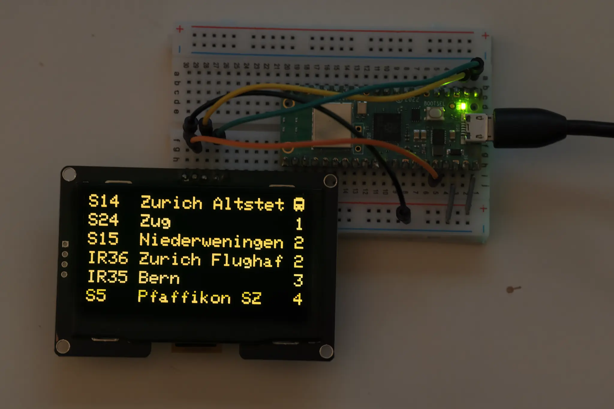

## About

This project was inspired by the ZVV departure displays around Zürich. I have previously completed this project in 2023, but wasn't truly satisfied. Now that I am a more skilled programmer, I decided to have another go.

The Pi Pico connects to your wifi where it fetches `stationboard` events from the Swiss [Transport API](https://transport.opendata.ch/docs.html#stationboard) and displays them nicely formatted on a attached 128x64 IIC Oled display.

## Details

No API key is needed. Currently, the stop ID and wifi credentials need to be configured manually in the code. In the future, I plan to implement setup using a captive portal.

12 new departures are fetched every 3 minutes, and the departure times are updated every 10 seconds. If less departures than rows (6) are available, new departures are fetched immediately.

The spacing adjusts